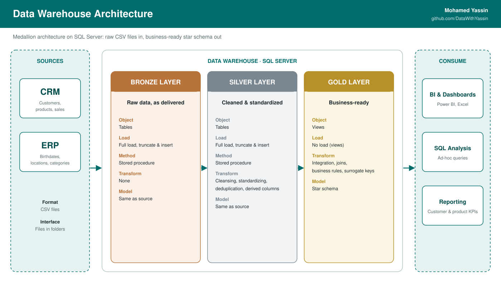
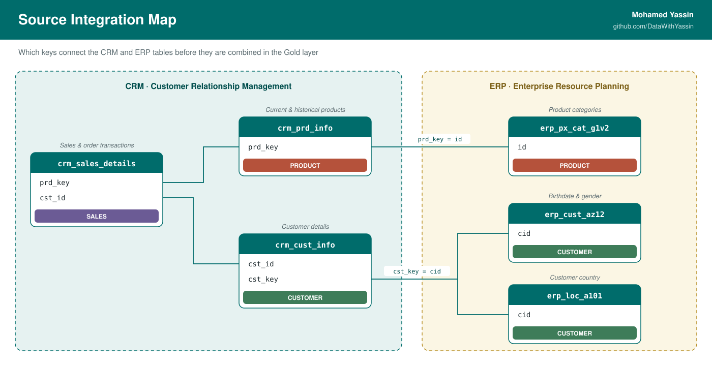
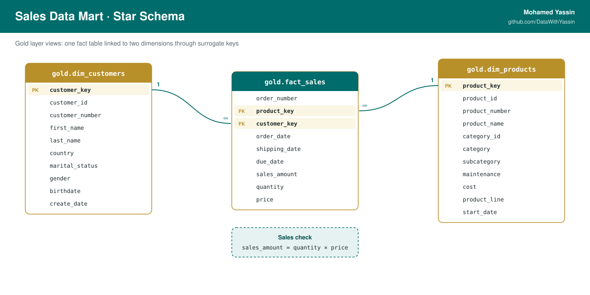
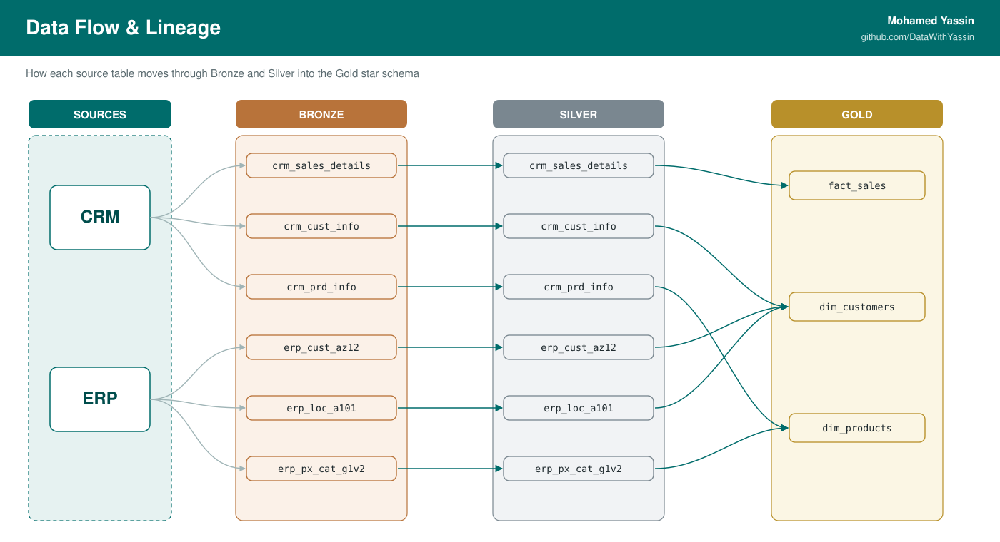

# SQL Data Warehouse | ERP + CRM Sales Data


A SQL Server data warehouse that combines sales data from two source systems (ERP and CRM), cleans it, and models it into a star schema ready for reporting and analysis.

---

## Business problem

Sales, customer, and product data sat in two separate systems, delivered as CSV exports with different formats, duplicate records, inconsistent codes, and invalid dates. Analysts could not trust a single number without cleaning the data by hand every time.

**Goal:** one clean, documented data model that answers sales questions directly.

---

## Architecture



The warehouse follows the **Medallion Architecture**:

| Layer | Purpose | Load type |
|---|---|---|
| **Bronze** | Raw data loaded as-is from the ERP and CRM CSV files | Full load (truncate and insert) via stored procedure |
| **Silver** | Cleaned, standardized, and validated data | Full load via stored procedure |
| **Gold** | Business-ready star schema (views) for reporting | Views, no physical load |

---

## Data cleaning in the Silver layer

- Removed duplicate and null primary keys, keeping the latest record per customer
- Trimmed unwanted spaces in text fields
- Standardized coded values (for example gender and marital status) into readable labels
- Fixed invalid or out-of-order dates (order, ship, and due dates)
- Recalculated sales values where amount, quantity, and price did not agree
- Aligned customer and product keys across ERP and CRM so the two sources join correctly

Quality checks for each layer are in [`tests/`](tests/).

---

## Source integration



CRM sales link to CRM products and customers. ERP adds product categories (`prd_key` to `id`) and customer birthdate, gender, and country (`cst_key` to `cid`).

---

## Data model (Gold layer)



- `gold.dim_customers`: customer attributes from CRM, enriched with ERP birthdate, gender, and country
- `gold.dim_products`: product attributes with category and subcategory from ERP
- `gold.fact_sales`: sales transactions linked to both dimensions

Full column definitions: [`docs/data_catalog.md`](docs/data_catalog.md)
Naming rules: [`docs/naming_conventions.md`](docs/naming_conventions.md)

---

## Data flow



---

## Repository structure

```
datasets/        Source CSV files (source_crm, source_erp)
docs/            Architecture, data flow, data model, catalog, naming conventions
scripts/
  init_database.sql
  bronze/        DDL and load procedure for the Bronze layer
  silver/        DDL and load procedure for the Silver layer
gold/            DDL for the Gold layer views
tests/           Data quality checks for Silver and Gold
```

---

## How to run

1. Run `scripts/init_database.sql` to create the database and schemas
2. Run the Bronze DDL, then `EXEC bronze.load_bronze;`
3. Run the Silver DDL, then `EXEC silver.load_silver;`
4. Run `gold/ddl_gold.sql` to create the reporting views
5. Run the scripts in `tests/` to validate the data

---

## Next step

The Gold layer feeds my [SQL Data Analytics project](https://github.com/DataWithYassin/SQL.Data.Analytics.Project), where I analyse sales trends, customer segments, and product performance.

---

## Acknowledgements

Built while following the SQL Data Warehouse course by [Data With Baraa](https://github.com/DataWithBaraa). Dataset provided by the course.

---

**Mohamed Yassin** | Data Analyst | [LinkedIn](https://www.linkedin.com/in/mohamedelesseily/) | [GitHub](https://github.com/DataWithYassin)
